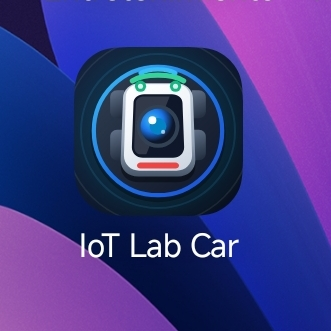
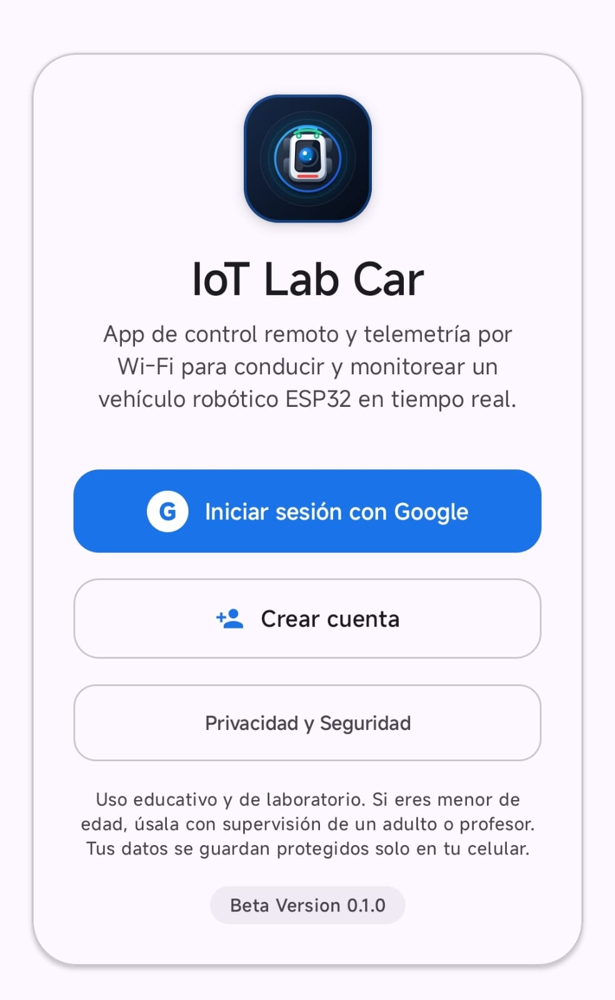
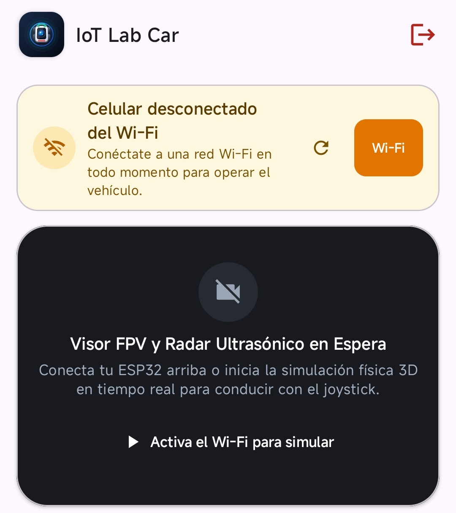
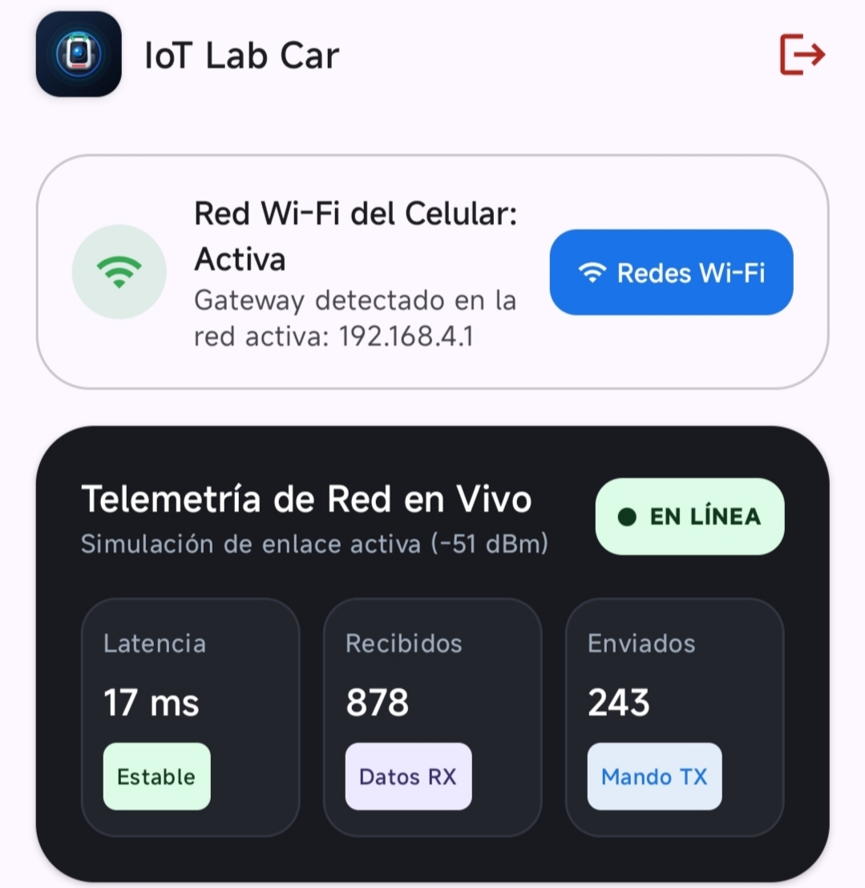
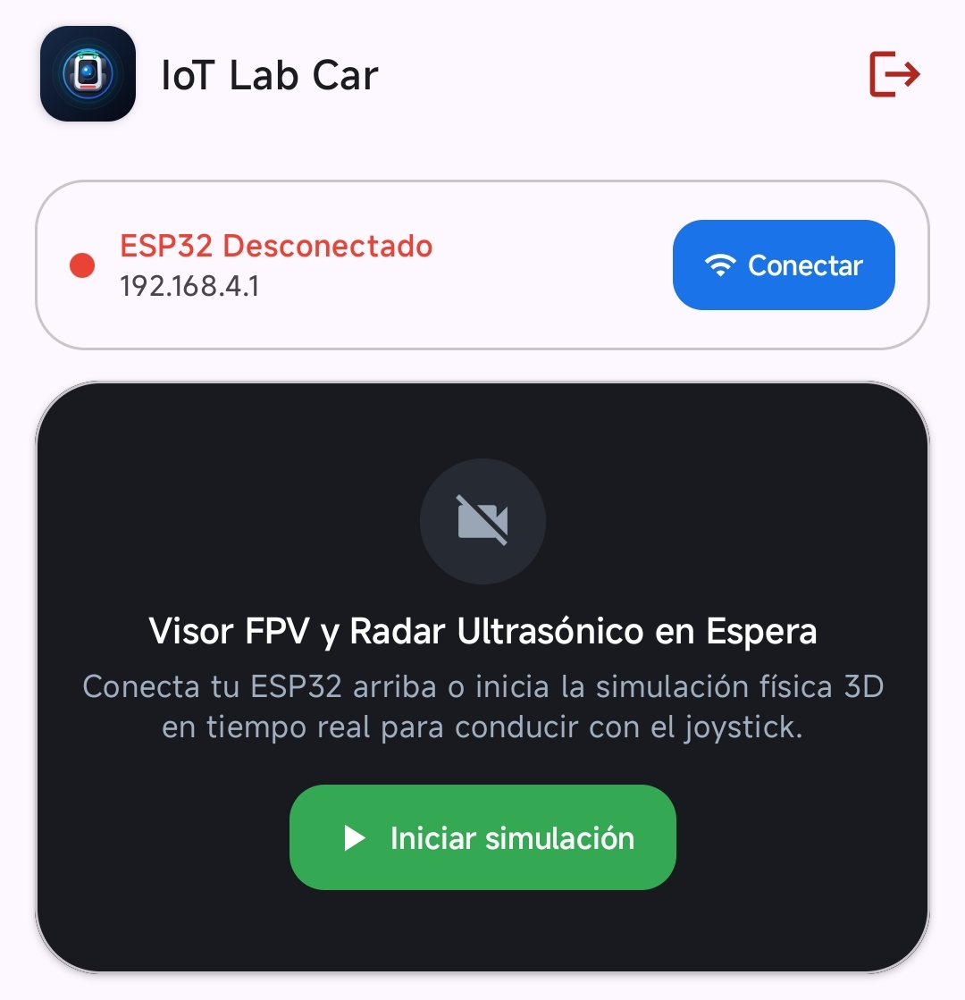
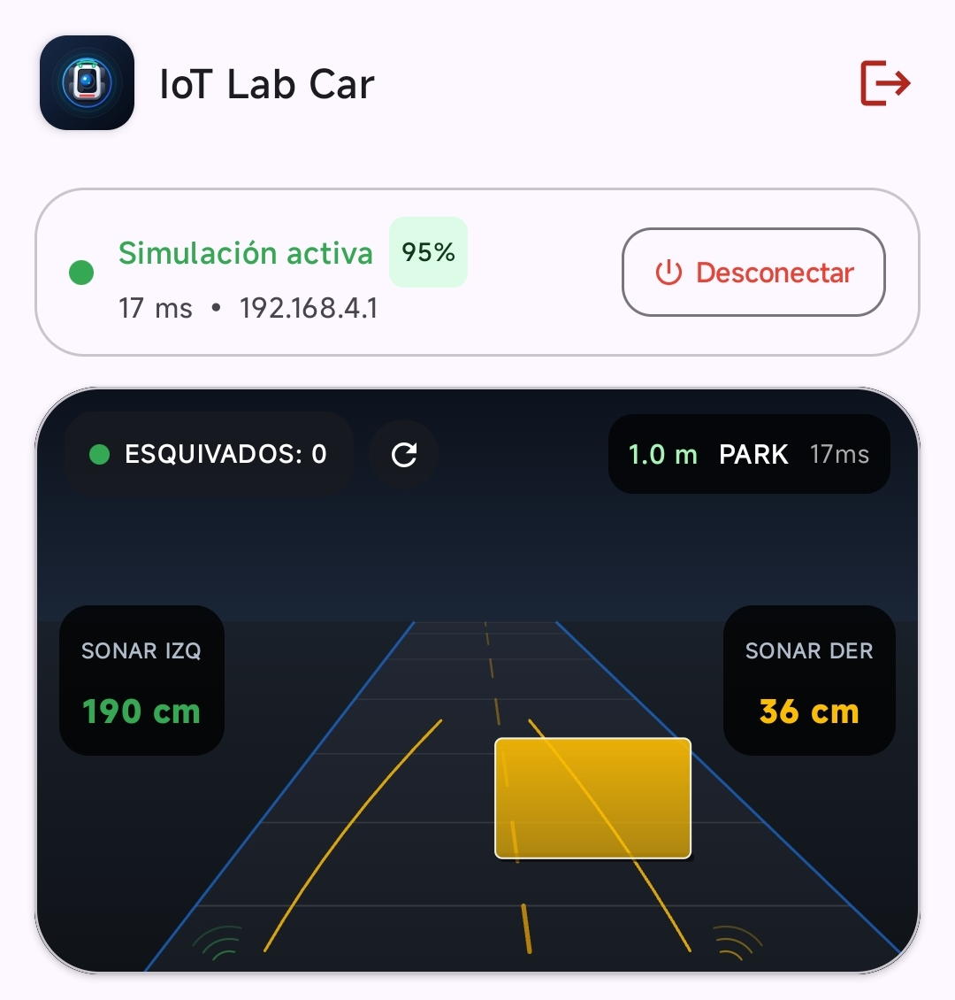
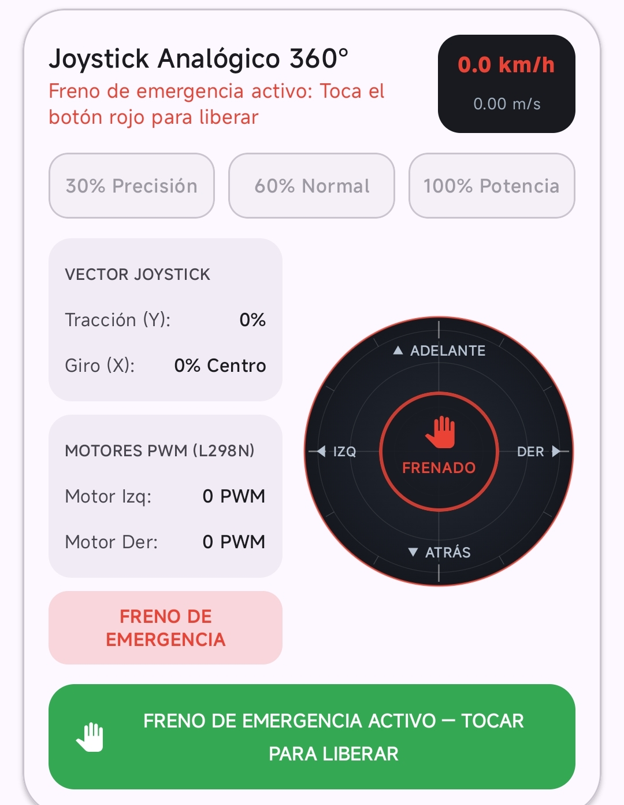
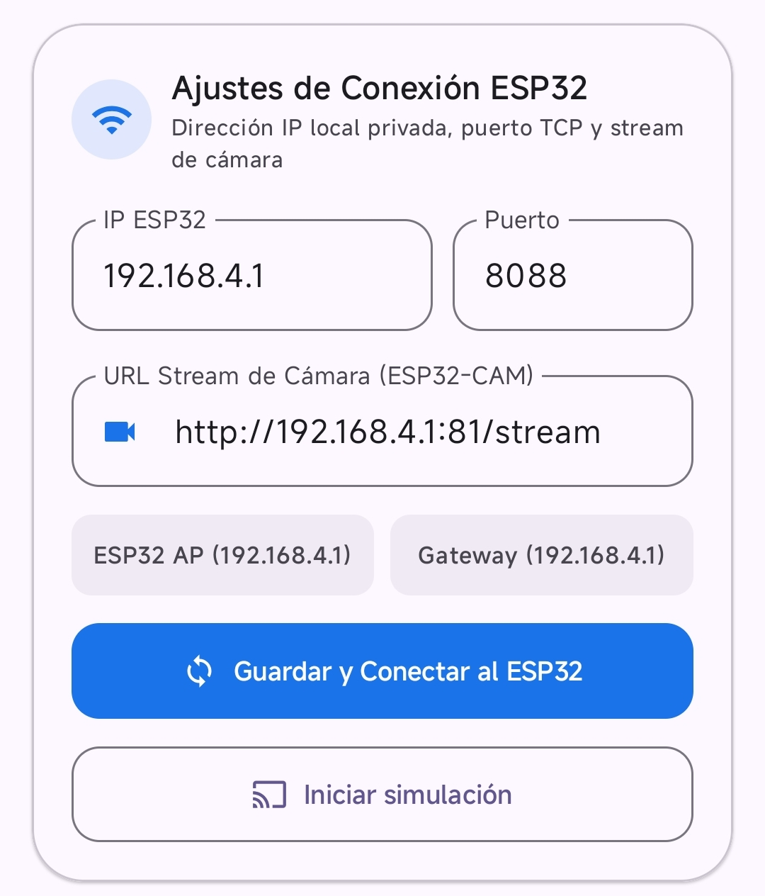

# IoT Lab Car

## Introduccion

IoT Lab Car es una aplicacion Android para controlar un vehiculo robotico ESP32 por Wi-Fi local. Permite conducir, ver la camara FPV, monitorear sensores ultrasonicos y ejecutar una simulacion cuando no hay hardware.

## Problematica resuelta

El control de vehiculos roboticos por Wi-Fi suele requerir configuraciones complejas y no ofrece una forma sencilla de observar el flujo de datos, los sensores y la seguridad. IoT Lab Car resuelve esto con una aplicacion Android que permite controlar un vehiculo ESP32, visualizar la camara en vivo y monitorear sensores ultrasonicos desde una interfaz clara y educativa.

## Justificacion de arquitectura

Se uso Jetpack Compose con Material Design 3 para la interfaz. El estado se gestiona con ViewModel y StateFlow, lo que permite sobrevivir a rotaciones de pantalla. La persistencia de sesion se realiza con EncryptedSharedPreferences usando AES-256 GCM. La comunicacion de red se ejecuta en Dispatchers.IO mediante sockets TCP y corrutinas. Se incluye un watchdog que detiene el vehiculo si se pierde la conexion. Las direcciones IP se validan para redes privadas RFC 1918.

## Caracteristicas

La aplicacion permite iniciar sesion con Google, guardar la sesion cifrada, validar permisos, conectar o desconectar el ESP32, iniciar una simulacion fisica, visualizar la camara FPV y el radar ultrasonico, controlar el vehiculo con un joystick, seleccionar la potencia y activar el freno de emergencia. Tambien muestra la telemetria de red y permite configurar la IP, el puerto y el stream de camara.

## Protocolo de comunicacion inalambrica

Protocolo IOT_EDU_V1 basado en JSON. Comando de control con campos protocol, seq, timestamp, command, speed, throttle, steering, pwmL y pwmR. Telemetria con ultrasonic (left_cm, right_cm, warning) y vehicle (state, battery_pct). Valores por defecto: IP 192.168.4.1, puerto TCP 8088, puerto de camara 81.

## Archivo APK

El APK se genera en app/build/outputs/apk/debug/app-debug.apk. Se entrega por separado en la plataforma.

## Requisitos

Se necesita Android Studio reciente, JDK 11 o superior, Android SDK 36, un emulador API 24 o superior o un dispositivo fisico con Android 7.0 o superior, una cuenta de Google, conexion a Internet para la primera sincronizacion de Gradle y una red Wi-Fi para ejecutar la aplicacion.

## Ejecucion

Abre el proyecto en Android Studio y espera la sincronizacion de Gradle. Crea el archivo .env a partir de .env.example. Selecciona un emulador o dispositivo y pulsa Run. Para probar en un telefono por USB, activa las opciones de desarrollador, activa la depuracion por USB, conecta el telefono, acepta la depuracion y selecciona el dispositivo antes de pulsar Run.

## Uso

Inicia sesion con Google y autoriza los permisos. Conectate a una red Wi-Fi. En Cabina, conecta el ESP32 o inicia la simulacion. Usa el joystick y selecciona la potencia. Revisa los sensores y alertas. Usa el freno de emergencia si es necesario. En Diagnostico y Red revisa la telemetria y configura la conexion.

## Pruebas

Las pruebas se ejecutan con ./gradlew test para las pruebas unitarias y ./gradlew connectedAndroidTest para las pruebas instrumentadas, que requieren un emulador o dispositivo conectado.

## Evidencia

<table>
<tr>
<td align="center"></td>
<td align="center"></td>
</tr>
<tr>
<td align="center"></td>
<td align="center"></td>
</tr>
<tr>
<td align="center"></td>
<td align="center"></td>
</tr>
<tr>
<td align="center"></td>
<td align="center"></td>
</tr>
</table>

## Estructura

El proyecto se organiza en la carpeta app, que contiene el codigo fuente, los recursos y las pruebas. La configuracion de Gradle se encuentra en la raiz del proyecto. El archivo COMO_EJECUTAR_Y_PROBAR.md contiene la guia detallada.

## Seguridad

La aplicacion guarda las sesiones con EncryptedSharedPreferences usando AES-256 GCM. Valida que las direcciones IP pertenezcan a redes privadas segun RFC 1918. Utiliza un watchdog que detiene el vehiculo si se pierde la conexion. Solicita permisos mediante un dialogo educativo y degrada sus funciones si son denegados. Sigue una arquitectura asincrona no bloqueante con corrutinas.

## Paquete

Nombre de paquete de la aplicacion: com.aistudio.iotvehicle.rcauto.

## Licencia

Este proyecto se distribuye bajo licencia MIT. Consulta el archivo LICENSE para mas detalles.

## Guia detallada

Consulta COMO_EJECUTAR_Y_PROBAR.md para el checklist completo de pruebas y pasos adicionales.